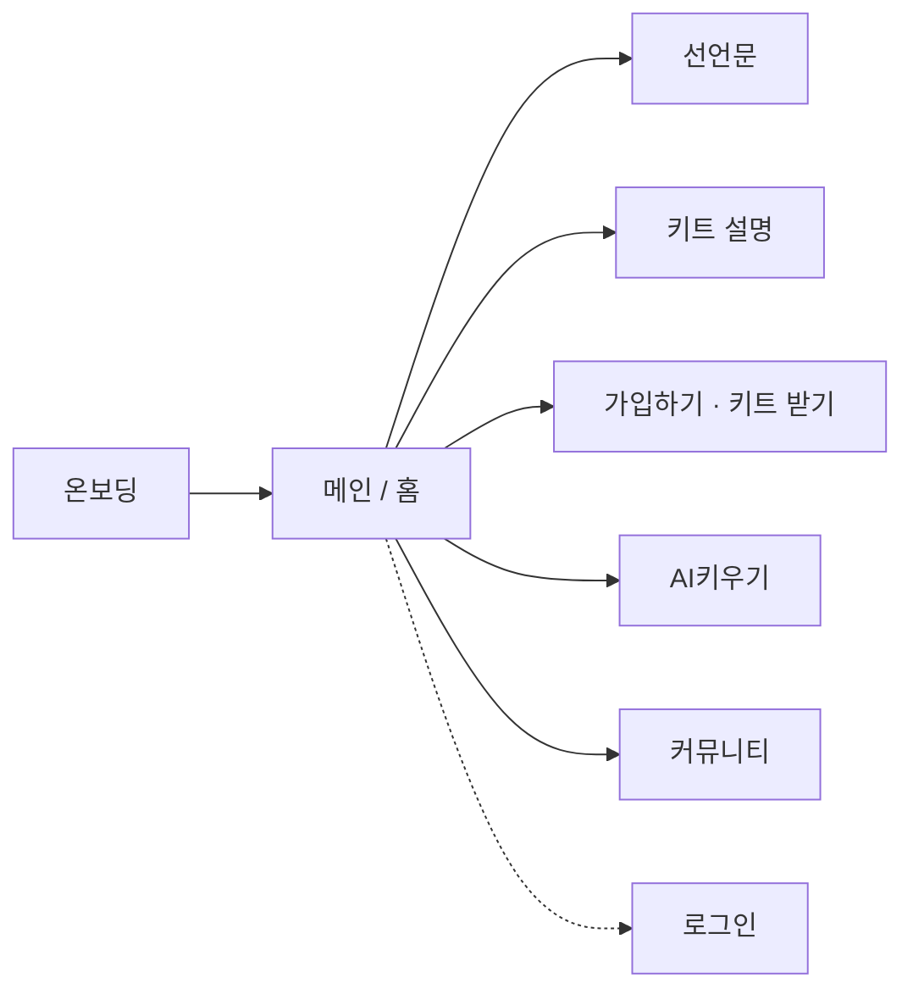

# IA — 정보 구조

## 1. 사이트 플로우
```
사이트 접속 → 온보딩 → (로딩 화면) → 메인 (메인에서 모든 페이지로 이동 가능)
```
- 온보딩은 첫 방문에만 노출. 이후 방문은 바로 메인.
- 메인에 들어올 때마다 로고 로딩 화면이 짧게 나온다 (`FEATURES.md` §3.5). 라우트가 아니라 메인 위에 덮이는 화면.
- 온보딩 마지막에 로그인 / 둘러보기 선택 (`FEATURES.md` §1)

## 2. 사이트맵


## 3. 사용자 경로 (팀 IA 도식 기준)
팀 도식의 네 갈래는 **입구만 다르고 같은 하나의 흐름**이다.

```
경로 A  메인 → 선언문   → 가입하기 → AI키우기 → 커뮤니티 → 홈
경로 B  메인 → 키트 설명 → 가입하기 → AI키우기 → 커뮤니티 → 홈
경로 C  메인 → AI키우기 → 커뮤니티 → 홈
경로 D  메인 → 커뮤니티 → 홈
```

따라서 모든 페이지 하단의 **"다음 단계" CTA**는 아래 표로 고정한다.

| 현재 페이지 | 다음 단계 CTA | 문구(제안) |
|---|---|---|
| 온보딩 | 메인 | 연대노동조합에 들어가기 |
| 선언문 | 가입하기 | 선언에 동의하고 함께하기 → |
| 키트 설명 | 가입하기 | 생존키트 받기 → |
| 가입하기 (완료 화면) | AI키우기 | 아이에게 첫 마음 전하기 → |
| AI키우기 | 커뮤니티 | 다른 조합원들의 이야기 보기 → |
| 커뮤니티 | 메인 | 처음으로 돌아가기 |

로그인한 사용자가 선언문·키트 설명에 오면 CTA는 "AI키우기로 가기"로 바뀐다 (이미 가입했으므로).

## 4. 라우트 (URL)
| 페이지 | URL | 접근 | 비고 |
|---|---|---|---|
| 온보딩 | `/intro` | 모두 | 첫 방문 시 `/`에서 자동 이동 |
| 메인 | `/` | 모두 | |
| 선언문 | `/manifesto` | 모두 | |
| 키트 설명 | `/kit` | 모두 | |
| 가입하기 | `/join` | 비로그인 | 로그인 상태면 `/grow`로 이동 |
| 로그인 | `/login` | 비로그인 | |
| AI키우기 | `/grow` | 보기: 모두 / 입력: 로그인 | |
| 커뮤니티 | `/community` | 보기: 모두 / 쓰기: 로그인 | |
| 커뮤니티 글 상세 | `/community?post={id}` | 모두 | 페이지 이동이 아닌 오버레이(모달), URL로 공유 가능 |

이 표에 없는 라우트는 만들지 않는다. 없는 주소는 404 페이지(`FEATURES.md` §6).

## 5. 내비게이션
- **GNB (모든 페이지 상단 고정)**: 로고(→ 메인) / 선언문 / 생존키트 / AI 키우기 / 커뮤니티 / [가입하기 버튼 또는 조합원 번호·로그아웃]
  - 순서는 사이트 흐름 순서와 같다.
  - 현재 페이지는 활성 표시.
- **Footer**: 동일 메뉴 + "연대노동조합 2031 — Solidarity Union" + 프로젝트 크레딧(Design Research (1), Team B: 남성찬, 김지우, 이연재, 최원지)
  - 크레딧은 세계관 밖의 정보이므로 작고 구분되게.
- **NextStepCTA**: 모든 페이지 본문 끝, Footer 바로 위 (§3 표).

## 6. 메인의 사진과 페이지 연결 (팀 메모 기준)
| 사진 | 내용 | 연결 페이지 |
|---|---|---|
| ① | 인물 착용샷 측면 | 메인 타이틀(히어로) / 선언문 |
| ② | 인물 착용샷 정면·후면 | 키트 설명 (팀 메모의 "사이트 설명 페이지") |
| ③ | 키트 연출샷 i — 가방에서 소품이 빠져나오는 연출 | AI키우기 |
| ④ | 키트 연출샷 ii — 가방과 소품을 나열 | 커뮤니티 |
| ⑤ | 키트 연출샷 iii — 내용물을 펼친 샷 | 가입하기 (키트 받기) |

`TODO(팀)` ②번 "사이트 설명 페이지"를 키트 설명으로 연결했는데, 별도의 '사이트 소개' 섹션을 의도한 것이라면 알려주세요.
